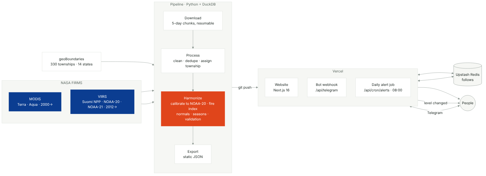
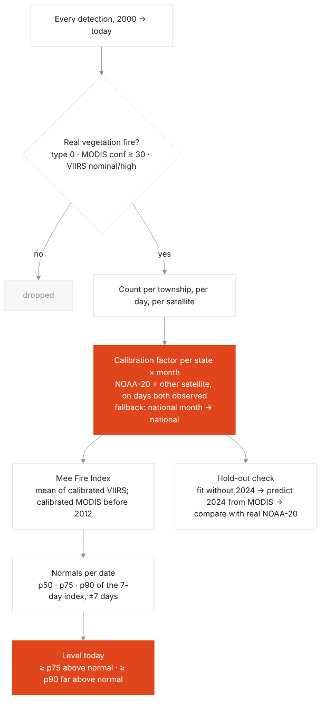

<div align="center">


# Mee <sub>မီး</sub>

**Myanmar's fire seasons, day by day.**
NASA satellite fire data for every township in one consistent calendar, with alerts when fire activity is above normal.

[](https://meefire.app)
[](https://t.me/mee_fire_bot)
[](https://firms.modaps.eosdis.nasa.gov/)
[](LICENSE)
<br />
[](web)
[](pipeline)
[](pipeline)
[](https://github.com/thesithunyein/mee/commits/main)

[Website](https://meefire.app) · [Telegram alerts](https://t.me/mee_fire_bot) · [How it works](https://meefire.app/method) · [Report a problem](https://github.com/thesithunyein/mee/issues/new/choose)

</div>

---

## The problem

**1. Every year, Myanmar burns, and people find out too late.**
From about January to May, fires burn across Myanmar: farm clearing, forest fires and burning along the borders. Smoke covers cities and villages for weeks. Fire teams, forest departments and health workers need to know *when* the season is starting and *whether this year is worse than usual*, early enough to act.

**2. NASA has the data, but it doesn't add up.**
Satellites have recorded every large fire since 2000, but the record is split across five satellites that see fire very differently:

| Satellite | Instrument | Pixel size | Data from |
|---|---|---|---|
| Terra, Aqua | MODIS | 1 km | 2000 |
| Suomi NPP, NOAA-20, NOAA-21 | VIIRS | 375 m | 2012 |

VIIRS sees far more small fires. In 2019, **NOAA-20 recorded 313,048 fire detections over Myanmar, while MODIS recorded 56,667** for the same place and year. Put them on one chart and 2012 looks like the year fires exploded, when really a better satellite was launched.

**3. The record is breaking right now.**
Fire data from Suomi NPP stopped on 2 November 2026, and NASA plans to end Terra and Aqua data collection in 2027. Any simple fire chart will soon show fire "dropping" just because satellites are switching off.

**4. Nobody can answer the simple question.**
Without one consistent record, a fire manager can't tell whether this week in their township is normal for the time of year or a warning sign. Historical patterns, unusual conditions and critical periods stay hidden in raw files that few people can use.

## What Mee does

Mee merges all five satellites into **one consistent record from 2000 to today**, on the scale of NOAA-20, the satellite that keeps operating. It then turns that record into something people can use:

| | |
|---|---|
| **Fire calendar** | For Myanmar, its 14 states and regions, and its 330 townships. One row per year, one square per day. |
| **This week vs normal** | The last 7 days against the same week in every past year. Each place is marked *Normal*, *Above normal* or *Far above normal*. |
| **Telegram alerts** | Follow any township in [@mee_fire_bot](https://t.me/mee_fire_bot) and get a message when its fire level changes. |
| **Updated every day** | New NASA data is processed automatically every morning, with no manual work. |
| **Season facts** | Start, busiest week, end and total for every year, compared with a typical year. |
| **Open data** | Daily CSV download for any area. Free to use with credit. |

**Who it's for:** emergency responders, forest and land managers, farmers' groups, health workers watching smoke, researchers and journalists.

**Does the merging work?** With 2024 held out of the fitting, raw MODIS got Myanmar's yearly total wrong by **−82%**. After Mee's scaling, the error is **+3%**. See [Validate](#the-harmonization-method) below.

### What happens when satellites stop?

Mee is built for satellites that come and go.

- **The old satellites are ending; the new ones continue.** MODIS on Terra and Aqua ends in 2027, and Suomi NPP fire data stopped in November 2026. NOAA-20 and NOAA-21, the newest VIIRS satellites, keep operating, and NASA FIRMS publishes their fire data for free.
- **Nothing breaks when MODIS stops.** Every satellite is already converted to the NOAA-20 scale. The history from 2000 was tied to NOAA-20 while both were flying (2018–2026), so it stays comparable after MODIS is gone. The daily update already uses only NOAA-20 and NOAA-21.
- **New satellites plug in the same way.** When a new fire satellite starts, Mee compares it with NOAA-20 on days both observe, computes a factor for each state and month, and adds it. That's exactly how NOAA-21 was added.
- **The method isn't tied to one data provider.** Other open fire products, such as Europe's Sentinel-3 or Japan's Himawari, could be calibrated the same way if ever needed.

In short: Mee saves 25 years of MODIS history by tying it to the satellites that will keep flying.

## How it works

<p align="center"></p>

### The harmonization method

<p align="center"></p>

1. **Download** all MODIS and VIIRS active-fire detections for mainland Southeast Asia from the [FIRMS area API](https://firms.modaps.eosdis.nasa.gov/api/area/): the standard archive plus near-real-time data.
2. **Clean:** keep vegetation fires only, drop low-confidence detections and count repeats once.
3. **Assign** each detection to its township and state.
4. **Calibrate** each satellite to NOAA-20 for every state and calendar month, using only days when both satellites observed. Sparse cases fall back to national factors.
5. **Fire index:** the average of the calibrated VIIRS estimates for each township-day, or calibrated MODIS before VIIRS existed. The unit is *NOAA-20-equivalent detections*.
6. **Normals:** percentiles of the 7-day index for each date across past years.
7. **Validate:** leave 2024 out, fit on every other year, predict 2024 from MODIS alone, and compare with what NOAA-20 really saw.

| 2024 hold-out, 571 state-weeks | MODIS as is | MODIS scaled by Mee |
|---|---|---|
| Error in Myanmar's yearly total | −82% | **+3%** |
| Typical weekly error per state | 81% | **31%** |
| Weekly correlation with NOAA-20 | 0.97 | **0.98** |

Raw MODIS tracks the *timing* of fires well but misses about four out of five of the fires NOAA-20 sees. After scaling, the yearly total is within 3%.

### Limits

- A detection is one hot pixel, not one fire, and not burned area or smoke.
- Clouds and thick smoke hide fires. Fires between satellite passes are missed.
- Calibration factors are averages for a state and month; single days can differ.
- Township borders are from geoBoundaries and may not match every official map.

Use Mee for patterns and early warning, and confirm on the ground before acting.

## Project structure

```
mee/
├── pipeline/                 Python data pipeline
│   ├── download_firms.py     FIRMS download (resumable, rate-limited)
│   ├── process.py            cleaning, township assignment, daily counts
│   ├── harmonize.py          calibration, fire index, normals, seasons, validation
│   ├── export_web.py         writes static JSON to web/public/data
│   ├── update_all.py         one command: download everything, then rebuild
│   └── nowcast.py            daily near-real-time update (runs on GitHub Actions)
├── web/                      Next.js 16 app (deployed on Vercel)
│   ├── public/data/          generated data the site and bot read
│   ├── src/app/              pages + API routes (/api/telegram, /api/cron/alerts)
│   ├── src/components/       calendar heatmap, season chart, map, search
│   └── src/lib/              types, map projection, Telegram + Redis helpers
└── docs/                     logo, diagrams (.mmd sources + rendered .png)
```

## Development setup

**You need:** Python 3.11+, Node.js 20+, git, and a free [FIRMS MAP_KEY](https://firms.modaps.eosdis.nasa.gov/api/map_key/).

### 1. Website

The site reads the data already committed in `web/public/data`, so it runs without the pipeline.

```bash
git clone https://github.com/thesithunyein/mee.git
cd mee/web
npm install
npm run dev          # http://localhost:3000
```

### 2. Data pipeline

```bash
cd pipeline
python -m venv .venv
# Windows:      .venv\Scripts\activate
# macOS/Linux:  source .venv/bin/activate
python -m pip install -r requirements.txt
cp .env.example .env   # then put your FIRMS_MAP_KEY in .env

python update_all.py   # first run downloads ~26 years of data (1-2 hours), then rebuilds
```

| Command | What it does |
|---|---|
| `python update_all.py` | Downloads anything missing (newest data first), then rebuilds everything |
| `python update_all.py --nrt-only` | Daily refresh: only this week's near-real-time data, then rebuild |
| `python update_all.py --skip-download` | Rebuild from what is already downloaded |
| `python download_firms.py --availability` | Shows which dates FIRMS has for each satellite |

Raw downloads go to `data/` (git-ignored; several gigabytes).

**Daily updates run on their own.** A GitHub Action ([`daily-update.yml`](.github/workflows/daily-update.yml)) runs [`nowcast.py`](pipeline/nowcast.py) every day at 06:10 Yangon time. It downloads the last 10 days of NOAA-20 and NOAA-21 near-real-time data, recomputes the fire index and every area's level with the same rules and calibration as the full pipeline, and commits the result. Vercel redeploys, and the 08:00 alert job messages Telegram followers. It needs one repository secret, `FIRMS_MAP_KEY`. On real data it matches the full pipeline to within 2% for Myanmar's 7-day total. The output goes to `web/public/data`. Commit that folder to publish new data.

### 3. Telegram alerts (optional)

1. Create a bot with [@BotFather](https://t.me/BotFather) and copy its token.
2. Add [Upstash Redis](https://vercel.com/marketplace/upstash) to the Vercel project (free tier).
3. Copy `web/.env.example` to `web/.env.local` (local) or add the same variables in Vercel → Settings → Environment Variables.
4. Deploy, then open `https://<your-site>/api/telegram/setup?key=<CRON_SECRET>` once to connect the bot.

The daily alert job is set in [`web/vercel.json`](web/vercel.json). Telegram can't reach `localhost`, so test the bot against a deployed preview.

## Security and privacy

- **Secrets** live only in `.env` files (git-ignored) and Vercel environment variables. Nothing secret is in the repository or sent to the browser.
- **The bot webhook** rejects any request without Telegram's secret token header. **The cron and setup routes** require `CRON_SECRET`.
- **Stored data:** only the Telegram chat ID and the list of places each chat follows. No names, phone numbers or locations. `/stop` deletes a chat's subscriptions, and chats that block the bot are removed automatically.
- **The site** has no accounts, no cookies and no tracking.

Found a vulnerability? Please report it privately. See [SECURITY.md](SECURITY.md).

## Contributing

Bug reports, data checks from people who know an area, and translations (Burmese first) are very welcome. Read [CONTRIBUTING.md](CONTRIBUTING.md) and the [Code of Conduct](CODE_OF_CONDUCT.md) first.

## Data and credits

- **NASA FIRMS:** MODIS Collection 6.1 and VIIRS 375 m active fires (Suomi NPP, NOAA-20, NOAA-21), from NASA LANCE / FIRMS, operated by NASA ESDIS. *We acknowledge the use of data and imagery from LANCE FIRMS operated by NASA's Earth Science Data and Information System (ESDIS) with funding provided by NASA Headquarters.*
- **Boundaries:** [geoBoundaries](https://www.geoboundaries.org/) gbOpen, Myanmar ADM1 and ADM3, CC BY 4.0, from The Myanmar Analytics Project.

Mee started at the NASA Space Apps Challenge 2026 (Yangon), for the *Harmonization of MODIS and VIIRS Hot Spots* challenge. It is independent and not affiliated with or endorsed by NASA.

## Use of AI tools

I used Claude (Anthropic) as a coding assistant: writing and debugging pipeline and web code, and checking API documentation. Mee itself contains no AI. Every number comes from the deterministic steps above. Design, data choices and testing are my own.

## License

[MIT](LICENSE) © 2026 Sithu Nyein. Data keeps its original licenses: NASA FIRMS (open, credit requested) and geoBoundaries (CC BY 4.0).
